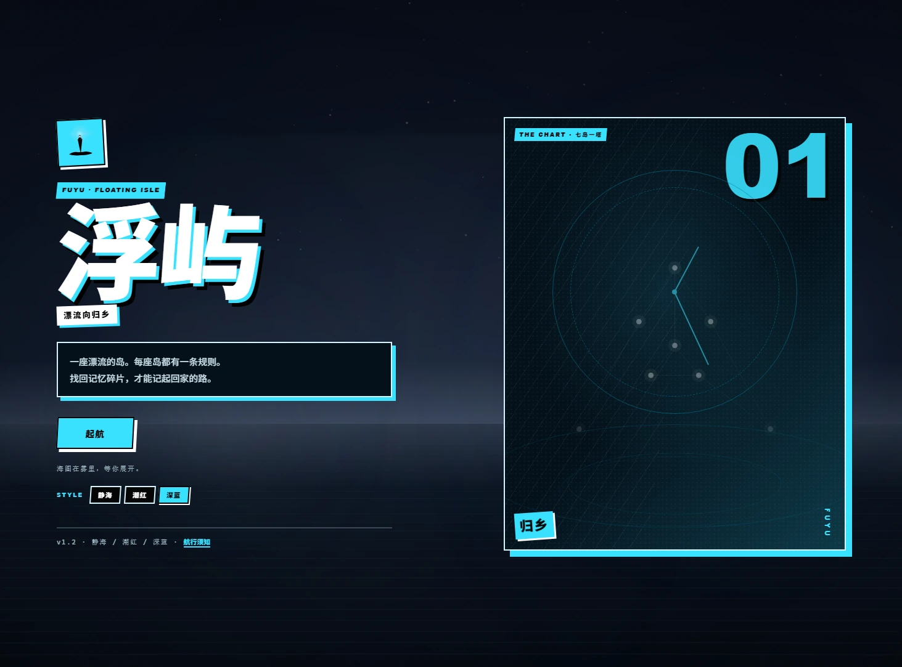

# 浮屿 · Fuyu — Floating Isle

> 一座漂流的岛。每座岛都有一条规则。
> 找回记忆碎片，才能记起回家的路。

《浮屿 · 九灯》是一款零依赖的开源网页叙事游戏，一次 **boy meets girl** 的暗调挽歌：灯塔尽灭的灰海上，渔村少年带着最后一粒火种出航——火在他掌心里站了起来，变成一个少女。

她没有影子，海不记她的航迹，秤称不出她的重量；她叠东西的动作，和收灯的人一模一样。九座漂流岛各有一条从不解释自己的规则；拾回十块记忆，她就亮一分——直到塔下你才知道她由什么构成，以及那个必须由你做的选择。

> v2.0《九灯》为默认书；地址加 `?book=v1` 可玩 v1 的前作《浮屿》（九岛一塔原版航线）。


## v2.0 · 九灯 · boy meets girl 暗调挽歌

- **她**：由火而生的少女（灯璃）。光以你的记忆为薪；神秘按阶梯释放——没有影子、无航迹、无声响、无重量，直到塔下揭晓她由所有被灯收走的"舍不得"构成。
- **他**：收灯人。白手套、木箱，叠灯如叠遗物；"烧过的东西，要收好。"
- **九岛暗调重写**：机制全保留（回声 / 折页 / 代价 / 归还），每座岛是她的一层谜题；纸月夜话可"追问她的过去"——代价是一块记忆作薪。
- **第一塔终章**：叫门两遍、影子折成楼梯、芯盒添薪——机制合流的告别仪式；四个结局各有真实门槛（拂晓 / 守夜 / 燃料 / 收灯）。
- **全程序化视觉**：海面、雾、cut-in、星图全部代码绘制，不加载任何图片素材；`scripts/gacha.mjs` 保留一条 AI 抽卡管线（未启用）备用。
- **双书并行**：`data/worlds.json`（v1）与 `data/worlds.v2.json`（v2）共存。

## v1.3 · 两座新岛，与值得回航的理由

- **重诺屿**：一座把话打成结的岛。在这里，许出去的话要**许两遍**——第一遍给海听，第二遍才算数；过礁石滩，要么押上一块记忆，要么从水里走。
- **叠浪**：一片被折起来的海。先把脚下这层海**折起来**，路才会出现；而折起的路，**每一步要走两遍才踩得实**——抄近路的人会被浪送回起点。
- **结局收藏**：结局屏现在会展示 4 个结局的收藏格与“还有几个在雾里”，拉你换一条路再航一次。
- **带走星图**：结局屏与航海日志可以把记忆星图导出为 PNG 分享图，全部程序化绘制，零依赖。
- **存档只存 ID**：进行中的存档不再保存正文文本，改版文案后旧存档读到的是新内容，坏引用会被安全丢弃。
- **cut-in 频率开关**：「航行须知」里可以在“全部”与“仅靠岸与结局”之间切换，选择保存在本机。
- **无障碍与打磨**：日志标签页支持方向键、屏幕切换后的焦点管理补全；修复 900–1100px 区间海图表头与图框的宽度差。

## v1.2 · 桌面版，以及更狠的潮红、更冷的深蓝

- **桌面版式重做**：标题页改成 80rem 双栏海报（左文右星图）；正文 46rem；海图 640；航海日志桌面双栏；结局 54rem。手机仍保持单列。
- **潮红：更大的拼贴**：半调网点、红色斜带、`01`、`归乡` 贴纸与场景幽灵编号；起航 / 靠岸 / 拾回记忆 / 折页 / 付出代价 / 结局前会出现漫画 cut-in。
- **深蓝：钟表、水面与冷光**：标题海报加入钟面、指针、涟漪与冷色光晕，转场与按钮同步变冷。
- **静海也放大**：保留雾海、衬线、留白；桌面标题变成左文右星图的跨页。
- **风格只换界面，不换故事**：`STYLE`、页脚「风格」或 `T` 切换，选择保存在本机；主题与转场都是原创视觉，没有使用任何他人角色、标志、UI 布局、文本或音乐。


| 潮红（默认） | 深蓝 | 静海 |
| --- | --- | --- |
|  |  |  |

| 潮红 · 游戏内 | 深蓝 · 游戏内 |
| --- | --- |
|  |  |

## v1.0 · 一段完整的航线

- **七座岛、一座灯塔、四个结局**：序章 → 自由选择靠岸顺序 → 灯塔。（v1.3 起海图扩大到九座岛）
- **规则不只是文字**：
  - 在**回声阶**，同一步要走两次，第一次只是被你听见。
  - 在**纸月**，你要先把天折起来，路才会从折痕里出现。
  - 在**秤星岛**，代价会真的从你身上拿走一块记忆；而**归潮**会把失去的还回来。
  - 在**无名渡**，名字没有用，只有你做过的事能换一张船票。
- **海图航行**：七座岛 + 一座灯塔，灯塔至少需要四座岛的微光才会亮起。
- **航海日志**：记忆星图、规则摘录、观察手记、结局收藏。
- **会呼吸的海**：程序化 Canvas 海面、星图、雾、潮汐、灯塔光束；Web Audio 合成的环境声，不加载任何音频或图片素材。
- **记忆会留下来**：自动存档、v0.1 旧存档迁移、跨周目结局与碎片记录。
- **可以只用键盘**：数字键选择、J 日志、M 海图、S 环境声、T 风格、Esc 返回、? 帮助；尊重“减少动态”。
- **零依赖、零构建**：clone 下来，起一个静态服务器就能玩。

| 海图（潮红） | 记忆星图（潮红） |
| --- | --- |
|  |  |

| 纸月（静海） | 归乡（潮红） |
| --- | --- |
|  |  |

## 在线试玩

<https://exldiposen.github.io/fuyu/> —— 由 GitHub Pages 托管，打开即玩，无需安装。

## 本地运行

无需安装任何依赖。任选一种方式启动本地静态服务器：

```bash
# Node（推荐，零依赖）
npm start

# 或者 Python 3
python -m http.server 8000
```

然后打开 <http://127.0.0.1:8000>。

> 项目使用 ES Modules 与 `fetch`，必须通过本地服务器访问。
> 直接双击 `index.html` 会因浏览器安全策略无法运行。

## 操作

| 操作 | 键 |
| --- | --- |
| 选择 | 数字键 `1`–`9` / Tab + Enter |
| 打开航海日志 | `J` |
| 打开海图 | `M` |
| 环境声开关 | `S` |
| 切换界面风格 | `T` |
| 返回 / 关闭 | `Esc` |
| 航行须知 | `?` |

移动端可直接触控；所有界面都做了窄屏适配。

## 目录结构

| 路径 | 说明 |
| --- | --- |
| `index.html` | 应用入口 |
| `assets/style.css` | 静海主题与共享结构 |
| `assets/style-graphic.css` | 潮红 / 深蓝主题的剪贴层 |
| `data/worlds.json` | 第一本书《浮屿》的内容数据（`?book=v1`） |
| `data/worlds.v2.json` | 第二本书《九灯》的内容数据（默认） |
| `src/engine.js` | 纯状态机：旗标、条件、代价、回声、折页、结局 |
| `src/flow.js` | 界面流程纯逻辑：cut-in 决策、海图提示、结局收藏模型 |
| `src/render.js` | 场景、海图、日志、星图与结局的渲染 |
| `src/share.js` | 记忆星图 PNG 分享图导出 |
| `scripts/gacha.mjs` | AI 抽卡管线（未启用，备用） |
| `src/sea.js` | Canvas 海面、雾、潮汐、灯塔光束 |
| `src/audio.js` | Web Audio 环境声 |
| `src/save.js` | v2 存档、v0.1 迁移、跨周目记录 |
| `src/theme.js` | 静海 / 潮红 / 深蓝的切换与持久化 |
| `src/main.js` | 屏幕切换、交互与键盘 |
| `scripts/validate.mjs` | 内容图校验（可达性、引用、出口） |
| `scripts/serve.mjs` | 零依赖本地静态服务器 |
| `tests/` | 引擎与完整航线的单元测试 |
| `docs/CONCEPT.md` | 世界观、路线结构与设计原则 |
| `docs/WORLD_RULES.md` | 如何为《浮屿》写一座新岛 |
| `docs/ROADMAP.md` | 路线图与贡献记录 |
| `docs/CHANGELOG.md` | 版本记录 |
| `docs/HANDOVER.md` | 交接文档：现状、架构、发布、已知问题与检查清单 |

## 开发与校验

```bash
npm test           # 41 个测试：v1 引擎 / 航线 + v2《九灯》全书与结局门槛（Node 内置 test runner）
npm run validate   # 校验 worlds.json：场景可达、引用成立、每条路都能走到出口
npm start          # 本地服务器（默认 v2；?book=v1 玩前作）
```

在地址后加 `?debug=1` 会在 `window.__fuyu` 暴露一个本地调试钩子，可以跳转岛屿、直接查看结局。它只在带参数的页面里存在，用于内容调试，不参与正常玩法。

## 参与贡献

我们非常欢迎新岛屿、新规则、新碎片。内容全部以 JSON 数据承载，不需要会写代码也能参与。请先阅读 [docs/WORLD_RULES.md](docs/WORLD_RULES.md)。

接手项目、排查发布或继续做界面，请先读 [docs/HANDOVER.md](docs/HANDOVER.md)。

- 内容必须是原创的；不要搬运任何受版权保护的角色、文本、画面或音乐。
- 不要提交任何个人信息、隐私数据或真实住址。
- 提交前请跑 `npm run validate` 与 `npm test`。
- 新岛合并后，请在 [docs/ROADMAP.md](docs/ROADMAP.md) 的贡献记录里加一行。

## 状态

| 项目 | 状态 |
| --- | --- |
| 版本 | v2.0.1 · 九灯（boy meets girl · 暗调挽歌） |
| 内容 | 两本书并存：v2《九灯》11 世界 / 93 场景 / 10 碎片 / 4 结局；v1 前作 11 世界 / 87 场景 |
| 界面风格 | 静海 / 潮红 / 深蓝（默认潮红） |
| 美术 | 全程序化视觉（Canvas / SVG / CSS），零图片素材 |
| 依赖 | 无运行时依赖，无构建步骤 |
| 浏览器 | 支持 ES Modules、Canvas 与现代 CSS 的浏览器 |

## 开源协议

[MIT](LICENSE) © 2026 浮屿贡献者
