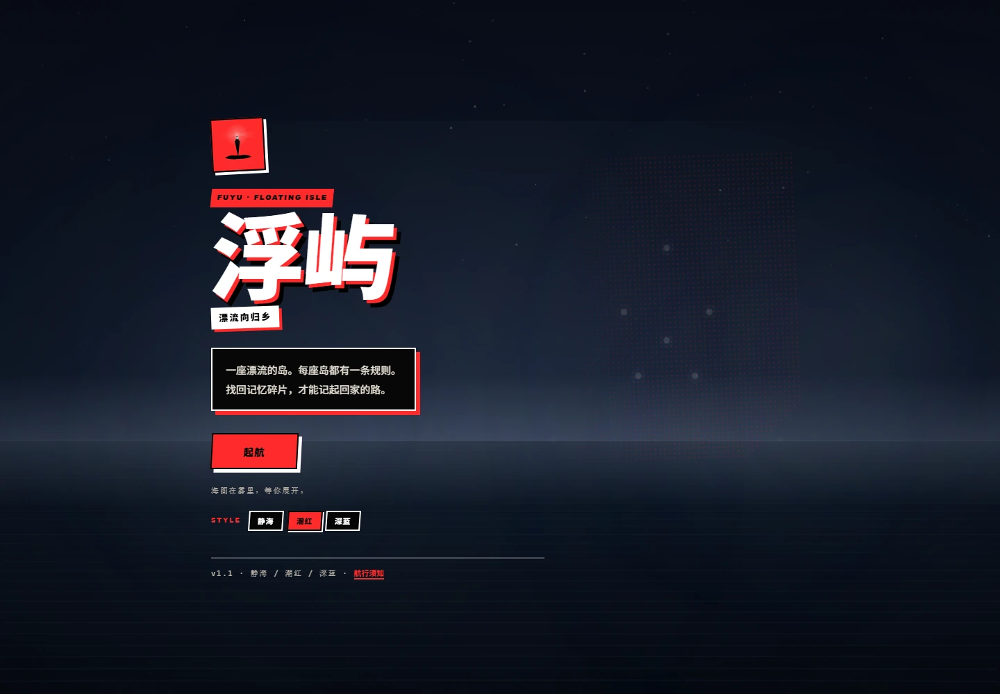
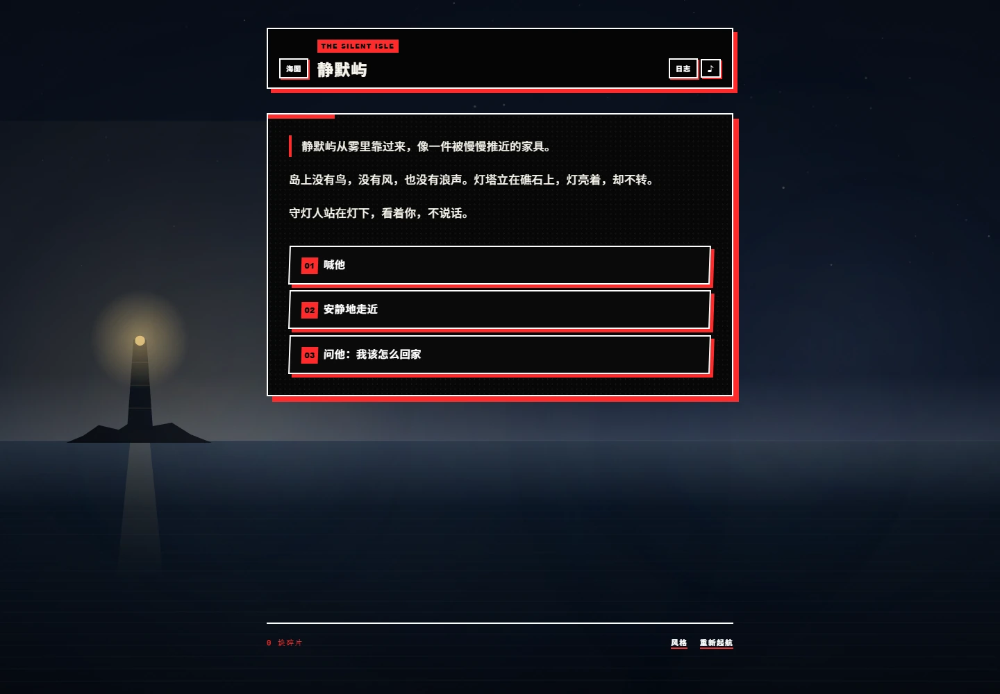
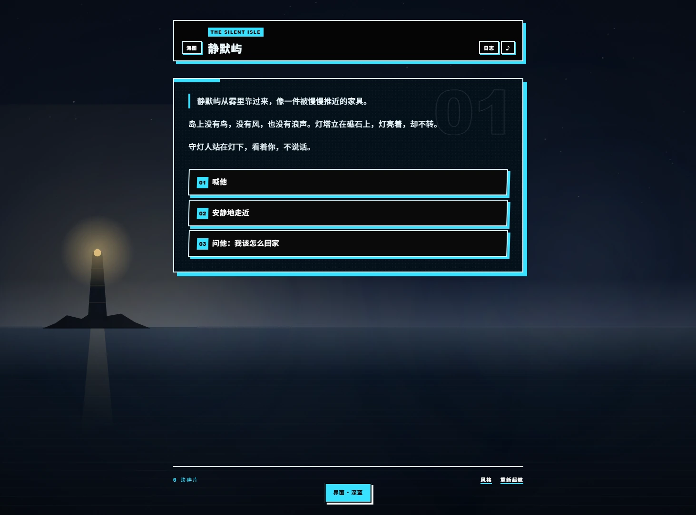
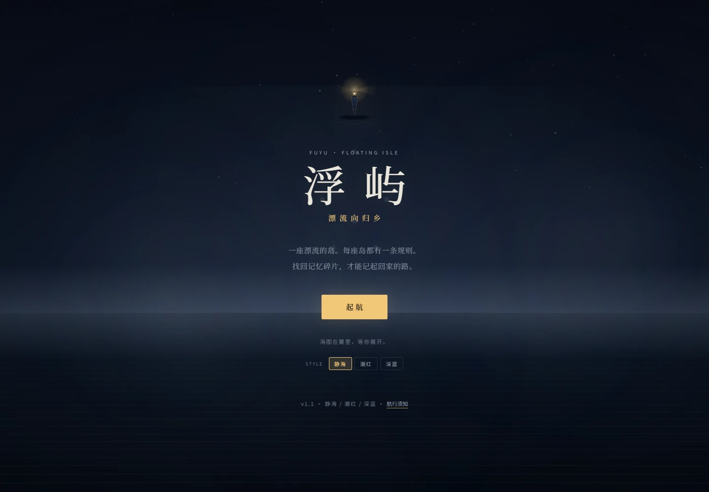
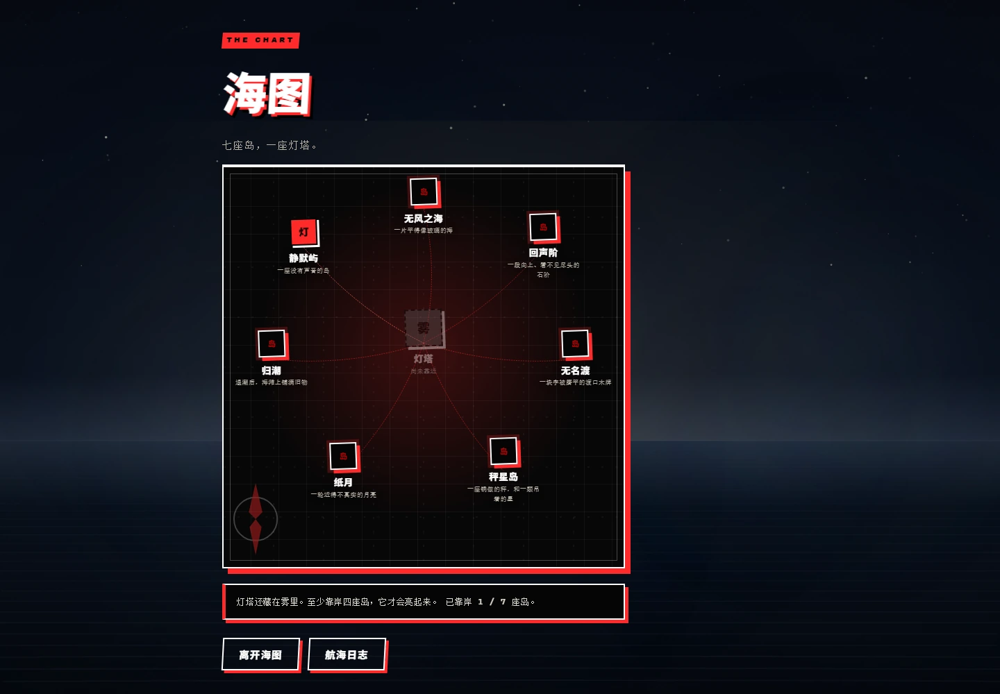
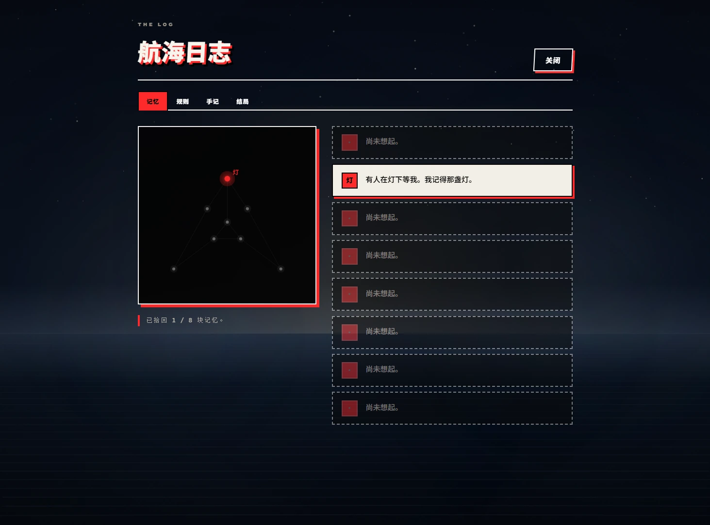
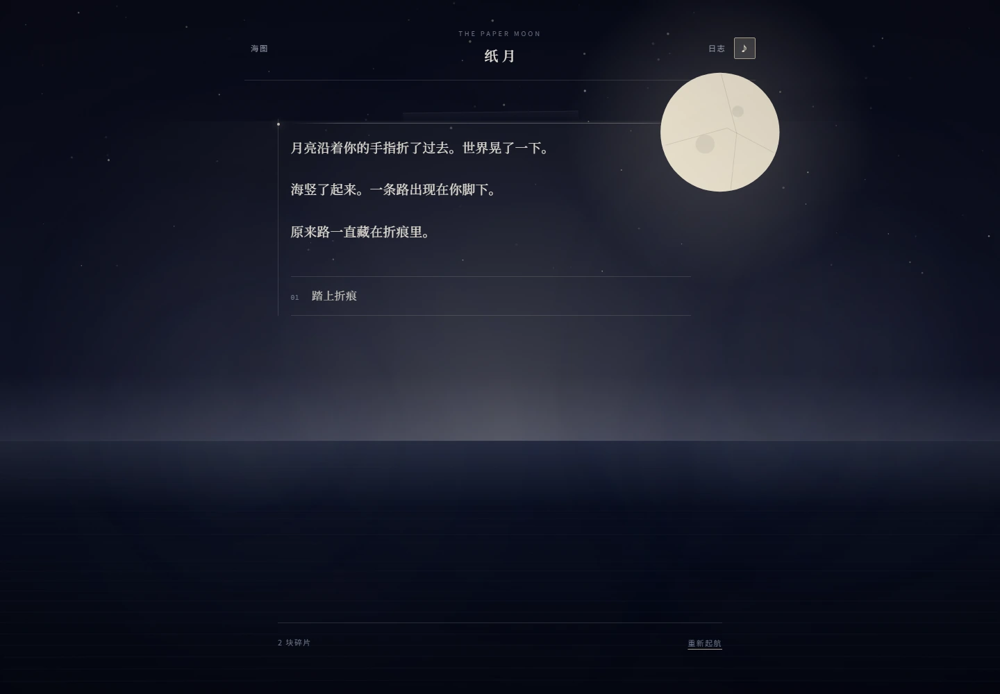
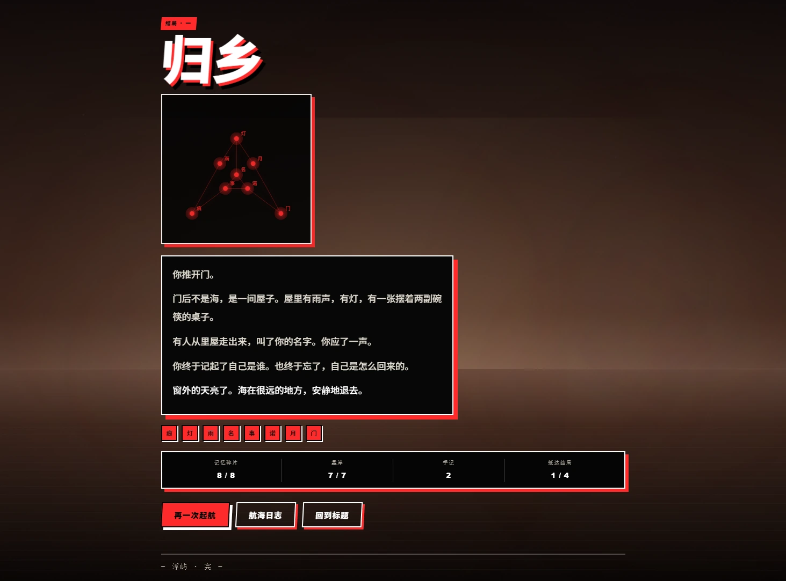

# 浮屿 · Fuyu — Floating Isle

> 一座漂流的岛。每座岛都有一条规则。
> 找回记忆碎片，才能记起回家的路。

《浮屿》是一款零依赖的开源网页叙事游戏。你是一个失忆的旅人，在七座漂流的岛与一座灯塔之间醒来；你不记得自己是谁，只记得两个字：**回家**。

每座岛都有一条从不解释自己的规则。理解它，你才能穿过这座岛；有时，你还要为理解它付出一点代价。八块记忆碎片散落在航线上，它们不会告诉你答案，只会让“你”变得更具体。最后，你站在灯塔下，决定自己要不要回家。



## v1.1 · 潮红 / 深蓝 / 静海

- **三套界面风格**：默认是「潮红」的红黑剪贴；也可以换成「深蓝」的蓝黑暗时，或回到原来的「静海」。
- **风格会改变界面，不改变故事**：海面、规则、碎片与结局都不变；只换一套看世界的方式。
- 标题页的 `STYLE`、游戏页脚的「风格」、或键盘 `T` 都可以切换，选择保存在本机。
- 这些主题是原创的视觉语言：红黑/蓝黑的硬阴影、斜切、半调网点、贴纸标签与粗体排版；没有使用任何他人角色、标志、UI 布局、文本或音乐。

| 潮红（默认） | 深蓝 | 静海 |
| --- | --- | --- |
|  |  |  |

## v1.0 · 一段完整的航线

- **七座岛、一座灯塔、四个结局**：序章 → 自由选择靠岸顺序 → 灯塔。
- **规则不只是文字**：
  - 在**回声阶**，同一步要走两次，第一次只是被你听见。
  - 在**纸月**，你要先把天折起来，路才会从折痕里出现。
  - 在**秤星岛**，代价会真的从你身上拿走一块记忆；而**归潮**会把失去的还回来。
  - 在**无名渡**，名字没有用，只有你做过的事能换一张船票。
- **海图航行**：七座岛 + 一座灯塔，灯塔至少需要四座岛的微光才会亮起。
- **航海日志**：记忆星图、规则摘录、观察手记、结局收藏。
- **会呼吸的海**：程序化 Canvas 海面、星图、雾、潮汐、灯塔光束；Web Audio 合成的环境声，不加载任何音频或图片素材。
- **记忆会留下来**：自动存档、v0.1 旧存档迁移、跨周目结局与碎片记录。
- **可以只用键盘**：数字键选择、J 日志、M 海图、S 环境声、T 风格、Esc 返回、? 帮助；尊重“减少动态”。
- **零依赖、零构建**：clone 下来，起一个静态服务器就能玩。

| 海图（潮红） | 记忆星图（潮红） |
| --- | --- |
|  |  |

| 纸月（静海） | 归乡（潮红） |
| --- | --- |
|  |  |

## 在线试玩

<https://exldiposen.github.io/fuyu/> —— 由 GitHub Pages 托管，打开即玩，无需安装。

## 本地运行

无需安装任何依赖。任选一种方式启动本地静态服务器：

```bash
# Node（推荐，零依赖）
npm start

# 或者 Python 3
python -m http.server 8000
```

然后打开 <http://127.0.0.1:8000>。

> 项目使用 ES Modules 与 `fetch`，必须通过本地服务器访问。
> 直接双击 `index.html` 会因浏览器安全策略无法运行。

## 操作

| 操作 | 键 |
| --- | --- |
| 选择 | 数字键 `1`–`9` / Tab + Enter |
| 打开航海日志 | `J` |
| 打开海图 | `M` |
| 环境声开关 | `S` |
| 切换界面风格 | `T` |
| 返回 / 关闭 | `Esc` |
| 航行须知 | `?` |

移动端可直接触控；所有界面都做了窄屏适配。

## 目录结构

| 路径 | 说明 |
| --- | --- |
| `index.html` | 应用入口 |
| `assets/style.css` | 静海主题与共享结构 |
| `assets/style-graphic.css` | 潮红 / 深蓝主题的剪贴层 |
| `data/worlds.json` | 所有岛屿、碎片、手记与结局的内容数据 |
| `src/engine.js` | 纯状态机：旗标、条件、代价、回声、折页、结局 |
| `src/render.js` | 场景、海图、日志、星图与结局的渲染 |
| `src/sea.js` | Canvas 海面、雾、潮汐、灯塔光束 |
| `src/audio.js` | Web Audio 环境声 |
| `src/save.js` | v2 存档、v0.1 迁移、跨周目记录 |
| `src/theme.js` | 静海 / 潮红 / 深蓝的切换与持久化 |
| `src/main.js` | 屏幕切换、交互与键盘 |
| `scripts/validate.mjs` | 内容图校验（可达性、引用、出口） |
| `scripts/serve.mjs` | 零依赖本地静态服务器 |
| `tests/` | 引擎与完整航线的单元测试 |
| `docs/CONCEPT.md` | 世界观、路线结构与设计原则 |
| `docs/WORLD_RULES.md` | 如何为《浮屿》写一座新岛 |
| `docs/ROADMAP.md` | 路线图与贡献记录 |
| `docs/CHANGELOG.md` | 版本记录 |

## 开发与校验

```bash
npm test           # 19 个引擎 / 航线测试，使用 Node 内置 test runner
npm run validate   # 校验 worlds.json：场景可达、引用成立、每条路都能走到出口
npm start          # 本地服务器
```

在地址后加 `?debug=1` 会在 `window.__fuyu` 暴露一个本地调试钩子，可以跳转岛屿、直接查看结局。它只在带参数的页面里存在，用于内容调试，不参与正常玩法。

## 参与贡献

我们非常欢迎新岛屿、新规则、新碎片。内容全部以 JSON 数据承载，不需要会写代码也能参与。请先阅读 [docs/WORLD_RULES.md](docs/WORLD_RULES.md)。

- 内容必须是原创的；不要搬运任何受版权保护的角色、文本、画面或音乐。
- 不要提交任何个人信息、隐私数据或真实住址。
- 提交前请跑 `npm run validate` 与 `npm test`。
- 新岛合并后，请在 [docs/ROADMAP.md](docs/ROADMAP.md) 的贡献记录里加一行。

## 状态

| 项目 | 状态 |
| --- | --- |
| 版本 | v1.1.0 · 潮红 / 深蓝 / 静海 |
| 内容 | 9 个世界 / 67 个场景 / 8 块碎片 / 21 则手记 / 4 个结局 |
| 界面风格 | 静海 / 潮红 / 深蓝（默认潮红） |
| 依赖 | 无运行时依赖，无构建步骤 |
| 浏览器 | 支持 ES Modules、Canvas 与现代 CSS 的浏览器 |

## 开源协议

[MIT](LICENSE) © 2026 浮屿贡献者
